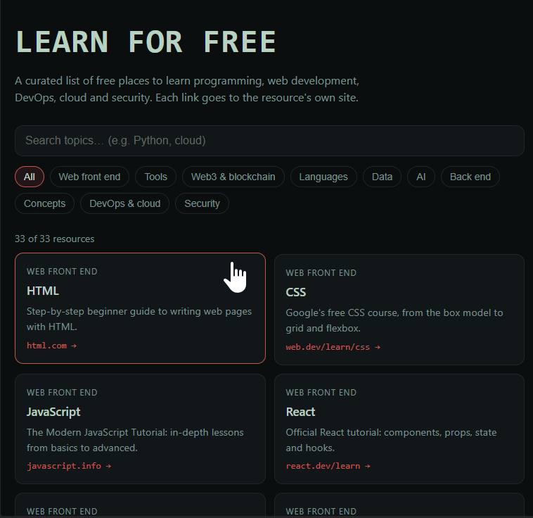

# learning-for-free

Here is a library of free courses and tutorials you can access at no cost. Whether you’re just starting out or picking up a new skill, these resources cover everything from HTML and Python to cloud computing and cybersecurity. No sign-up fees, just learning.

## Screenshot



## Features

- **33 free resources** across web development, programming languages, back end, data, AI, DevOps, cloud and security
- **Search** by topic, category, description or link
- **Category filters** to narrow the list with one tap
- **Short descriptions** of what each resource teaches
- **Works on phones**, with a dark theme
- **No frameworks or build step:** plain HTML, CSS and JavaScript

## Categories

| Category          | Topics                                                          |
| ----------------- | --------------------------------------------------------------- |
| Web front end     | HTML, CSS, JavaScript, React, Vue, Angular, Next.js, TypeScript |
| Languages         | Python, PHP, Go, Rust, C++, Java, C#, Swift                     |
| Back end          | API, Django, Flask                                              |
| DevOps & cloud    | Docker, Kubernetes, Linux, DevOps, AWS, GCP, Azure              |
| Web3 & blockchain | Web3, Blockchain                                                |
| Data              | SQL                                                             |
| AI                | AI basics                                                       |
| Tools             | Git                                                             |
| Concepts          | Design patterns                                                 |
| Security          | Cybersecurity                                                   |

## Run it locally

No install needed. Clone the repo and open `index.html` in your browser:

```bash
git clone https://github.com/yourname/learn-for-free.git
cd learn-for-free
open index.html   # macOS. On Windows use: start index.html
```

## Deploy with GitHub Pages

1. Push `index.html`, `style.css` and `script.js` to the `main` branch.
2. Go to **Settings → Pages**.
3. Under **Source**, choose **Deploy from a branch**, then pick `main` and `/ (root)`.
4. Save. Your site will be live at `https://yourname.github.io/learn-for-free` within a minute or two.

## Add or edit a resource

All resources are in the `resources` list at the top of `script.js`. Add a line like this:

```js
{ topic: "Svelte", category: "Web front end", url: "https://svelte.dev/tutorial", desc: "Official interactive Svelte tutorial." },
```

New categories get their own filter button automatically.

## Built with

- HTML
- CSS
- JavaScript

## Note

All links were checked in November 2026. Each resource belongs to its own creators. This project only links to them. If you find a broken link, please open an issue.
